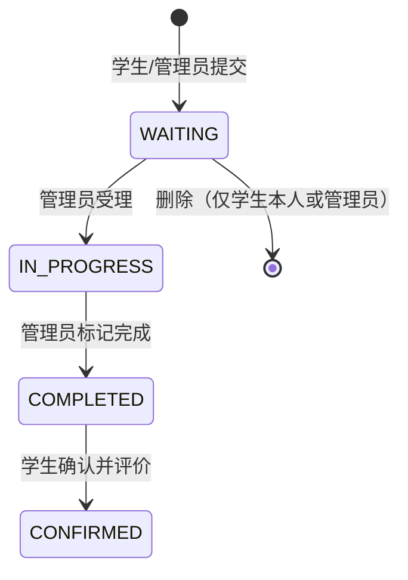
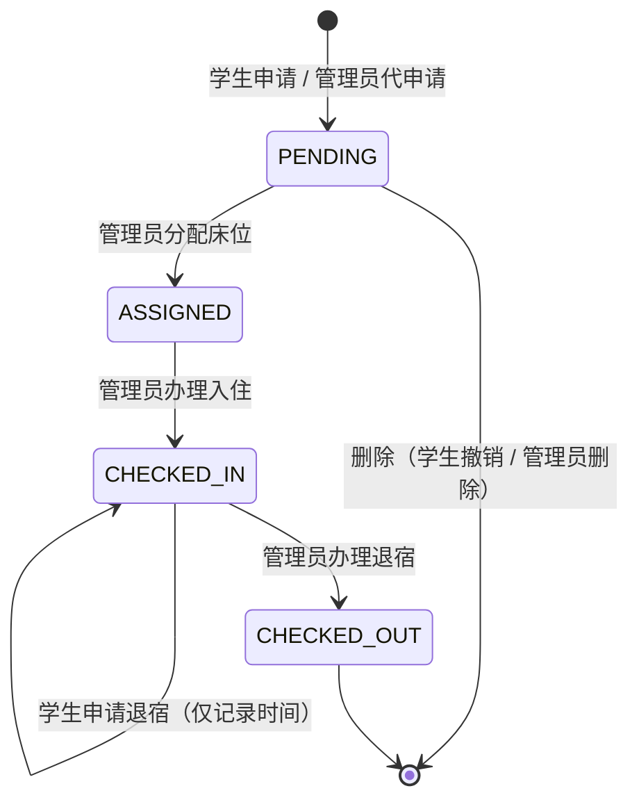

# 学生公寓管理系统 修复规格说明

| 项目 | 内容 |
| --- | --- |
| 文档版本 | 1.0 |
| 日期 | 2026-11-04 |
| 代码基线 | `main` @ `c7059b8` + 学生账号下拉修复（未提交） |
| 依据 | 2026-11-04 管理员与学生功能流程审查 |
| 文档状态 | 待评审 |

本文档把流程审查结论转成可实施、可验收的需求。每条需求包含现状证据、期望行为、技术设计与验收标准，可直接作为开发与测试的输入。

---

## 1. 背景与目标

系统为 Java 17 + Spring Boot 3.4 + JDBC + MySQL 8 的单体应用，前端为 Vue 3 + Arco Design 单页应用，由后端同源托管。管理员负责账号、学生、宿舍、床位等基础数据，以及报修受理、床位分配、入住与退宿办理；学生负责提交报修、评价、申请入住与退宿。

审查发现若干流程在**正常操作路径**上会产生不可逆状态或信息暴露。本规格的目标：

1. 消除会把业务卡死、只能改库才能恢复的状态；
2. 消除对外泄露的敏感信息；
3. 补齐管理端必要的审计与错误反馈；
4. 不改变现有技术栈、不重做界面风格。

**非目标**：通知系统、报表体系、移动端原生应用、多校区/多学期建模。

---

## 2. 现状基线

### 2.1 角色与权限

| 能力 | 管理员 | 学生 |
| --- | --- | --- |
| 数据概览 | ✔ | ✘ |
| 查看报修 | 全部 | 仅本人 |
| 新建报修 | 可代任意学生提交 | 仅本人 |
| 编辑/删除报修 | 仅 `WAITING` | 仅本人且 `WAITING` |
| 受理 / 完成报修 | ✔ | ✘ |
| 确认评价 | ✘ | 仅本人且 `COMPLETED` |
| 入住申请 | 可代学生提交 | 本人 |
| 分配床位 / 办理入住 / 办理退宿 | ✔ | ✘ |
| 申请退宿 | ✘ | 仅本人且 `CHECKED_IN` |
| 学生/宿舍/床位/账号维护 | ✔ | ✘ |
| 个人信息 | ✘（提示去账号管理） | ✔ |

权限在后端逐次校验（`SecurityConfig` 的 URL 规则 + `BusinessService` 的角色与归属校验），前端隐藏按钮只作辅助。

### 2.2 现有状态机

**报修（repair.status）**



**入住（housing.status）**



### 2.3 硬约束

1. **数据库须与作业2一致**：`README.md` 第 3 行明确"数据库与作业2的六实体、字段及状态保持一致"。本规格中带 **Schema 影响** 的需求会新增字段或状态取值，实施前须确认是否允许偏离；每条需求都给出了"不改表降级方案"。
2. **前端产物入库**：`frontend` 构建输出到 `src/main/resources/static`，随 jar 交付；改前端后必须重新 `npm run build` 与 `mvn package`。
3. **meta 驱动的通用 CRUD**：基础数据的新增/编辑弹窗由后端 `AdminService.entity()` 返回的字段与选项渲染，改动需同时考虑列表标签、编辑回填与新增选项三种用途。

### 2.4 已修复项（本规格不再覆盖）

- 新增学生时，学生账号下拉包含已被其他学生占用的账号 → 已改为按新增/编辑区分的表单选项（`AdminService.form()` + `GET /api/admin/{entity}/form`）。

---

## 3. 需求总览

优先级定义：**P0** 阻塞演示/上线；**P1** 数据或安全问题；**P2** 体验与可维护性；**P3** 可选优化。工作量：**S** ≤ 半天，**M** 1–2 天，**L** ≥ 3 天。

| ID | 标题 | 领域 | 优先级 | 工作量 | Schema 影响 | 依赖 |
| --- | --- | --- | --- | --- | --- | --- |
| REQ-01 | 取消床位分配（ASSIGNED 出口） | 入住 | P0 | S | 无 | — |
| REQ-02 | 退宿申请撤销与管理员强制退宿 | 入住 | P1 | S | 无 | — |
| REQ-03 | 报修驳回与状态回退 | 报修 | P1 | M | 是 | — |
| REQ-04 | 未建档学生账号的可达状态与引导 | 账号 | P0 | S | 无 | — |
| REQ-05 | 账号列表不下发密码哈希 | 安全 | P1 | S | 无 | — |
| REQ-06 | 学生不可自行修改学号 | 权限 | P2 | S | 无 | — |
| REQ-07 | 改密校验原密码并使其他会话失效 | 安全 | P2 | M | 无 | — |
| REQ-08 | 入住申请驳回（REJECTED 状态） | 入住 | P1 | M | 是 | — |
| REQ-09 | 关联数据删除给出具体原因 | 基础数据 | P2 | S | 无 | — |
| REQ-10 | 报修记录提交时的宿舍快照 | 报修 | P2 | M | 是 | — |
| REQ-11 | 报修处理人与时间审计 | 报修 | P2 | M | 是 | — |
| REQ-12 | 基础数据归档（软删除） | 基础数据 | P3 | L | 是 | 暂缓 |
| REQ-13 | 新增学生无可用账号时的引导 | 前端 | P2 | S | 无 | — |
| REQ-14 | 管理弹窗下拉支持搜索 | 前端 | P3 | S | 无 | — |
| REQ-15 | 学生端按钮按状态禁用 | 前端 | P3 | M | 无 | — |
| REQ-16 | 统计口径命名澄清 | 前端 | P3 | S | 无 | — |
| REQ-17 | 报修详情只读接口 | 报修 | P3 | S | 无 | REQ-03 |

---

## 4. 详细规格

### REQ-01 取消床位分配

**优先级** P0 ｜ **工作量** S ｜ **Schema** 无

**现状**：管理员在 `PENDING` 记录上分配床位后进入 `ASSIGNED`（`BusinessService.java:139`），而 `deleteHousing` 只允许 `PENDING`（`BusinessService.java:133`），`request-checkout` 要求 `CHECKED_IN`（`BusinessService.java:155`）。`ASSIGNED` 唯一出口是 `checkin`（`BusinessService.java:150`）。

**问题**：分配后学生未入住时，床位永久为 `OCCUPIED`、学生永久无法再次申请（`createHousing` 会拦截），只能直接改数据库。

**期望行为**：管理员可对 `ASSIGNED` 记录执行"取消分配"，记录退回 `PENDING`，床位立即释放并可再次分配。

**设计**

- 接口：`POST /api/housing/{id}/unassign`，仅管理员。
- `ApiController.java:54` 的动作正则增加 `unassign`。
- `BusinessService.housingAction` 新增分支：

```java
case "unassign" -> {
    if (!admin) throw new IllegalArgumentException("仅管理员可取消分配");
    status(h, "ASSIGNED");
    long bid = ((Number) h.get("bed_id")).longValue();
    var bed = locked("bed", bid);
    status(bed, "OCCUPIED");
    db.update("UPDATE bed SET status='FREE' WHERE id=?", bid);
    db.update("UPDATE housing SET bed_id=NULL, status='PENDING' WHERE id=?", id);
}
```

- 与现有约束兼容：`housing` 的 CHECK 允许 `PENDING` 且 `bed_id IS NULL`（`sql/assignment2-original.sql:79-81`）；生成列 `active_bed_id` 随之变为 `NULL`，释放唯一索引占位。
- 锁顺序与 `assign` 保持一致（housing → bed），避免死锁。
- 审计：不新增字段；如需记录取消时间，见 REQ-11 的扩展建议。

**前端**

- `Page.vue` 入住列表：`d.admin && record.status === 'ASSIGNED'` 时，在"办理入住"旁增加"取消分配"按钮（`danger` 样式）。
- 二次确认文案："取消后该床位将释放，申请退回待审核状态。"

**验收标准**

1. 对 `ASSIGNED` 记录执行取消分配 → 记录变 `PENDING`、`bed_id` 为空，床位变 `FREE`。
2. 被释放的床位出现在 `/api/admin/options/free-beds` 中，可分配给其他学生。
3. 学生端该申请重新显示为"待审核"，可再次被分配。
4. 学生对同一接口调用返回 4xx，记录状态不变。
5. 对 `CHECKED_IN` / `PENDING` 记录调用返回"记录状态已变化，不能执行该操作"。

**不改表降级方案**：无（本需求不改表）。

---

### REQ-02 退宿申请撤销与管理员强制退宿

**优先级** P1 ｜ **工作量** S ｜ **Schema** 无

**现状**：学生提交退宿申请只写入 `checkout_requested_at`（`BusinessService.java:154`）；`checkout` 要求该字段非空（`BusinessService.java:161`），且没有任何动作能清空它。

**问题**：误点申请后无法撤销；学生不申请时管理员无法办理（毕业生离校、学生失联）。

**期望行为**

- 学生可在管理员办理前撤销退宿申请。
- 管理员可不依赖学生申请直接办理退宿，并能在记录上区分"学生申请"与"管理员强制"。

**设计**

- 接口新增两个动作，加入 `ApiController.java:54` 的正则：
  - `POST /api/housing/{id}/cancel-checkout`（学生，本人记录，`CHECKED_IN`，`checkout_requested_at` 非空）→ 置 `NULL`。
  - `POST /api/housing/{id}/force-checkout`（管理员，`CHECKED_IN`）→ `CHECKED_OUT`、`check_out_at=NOW()`、床位 `FREE`，`checkout_requested_at` 保持 `NULL`。
- `force-checkout` 的床位释放逻辑复用 `checkout` 分支，差异仅在"是否要求已有申请"。
- 审计约定：`status='CHECKED_OUT' AND checkout_requested_at IS NULL` 即管理员强制退宿，无需新增字段。

**前端**

- 学生端：`CHECKED_IN && record.checkout_requested_at` 时显示"撤销退宿申请"。
- 管理员端：`CHECKED_IN && !record.checkout_requested_at` 时显示"强制退宿"，确认文案说明"该操作无需学生申请，立即释放床位"。

**验收标准**

1. 学生提交退宿申请后再撤销 → 时间为空，记录仍为 `CHECKED_IN`，管理员端不再显示"办理退宿"。
2. 管理员对学生未申请、已入住的记录执行强制退宿 → 状态 `CHECKED_OUT`，床位 `FREE`，`checkout_requested_at` 为空。
3. 学生调用 `force-checkout`、管理员调用 `cancel-checkout` 均被拒绝。
4. 重复调用同一动作返回状态已变化错误，不产生副作用。

**不改表降级方案**：无。

---

### REQ-03 报修驳回与状态回退

**优先级** P1 ｜ **工作量** M ｜ **Schema** 是

**现状**：`repairAction` 只有 `accept/complete/confirm`（`BusinessService.java:113`）；`deleteRepair` 限 `WAITING`（`BusinessService.java:110`）；状态枚举见 `sql/assignment2-original.sql:54-55`。

**问题**：无法拒绝无效/重复报修；误点"受理"后记录永久停在 `IN_PROGRESS` 或 `COMPLETED`，且占着处理率分母。

**期望行为**

- 管理员可驳回 `WAITING` 报修，并填写原因。
- 管理员可将 `IN_PROGRESS` 回退为 `WAITING`（可选）。
- 已驳回记录对学生可见，并显示原因。
- 处理率分母不含已驳回记录。

**设计**

Schema：

```sql
ALTER TABLE repair ADD COLUMN reject_reason VARCHAR(255) NULL;
-- 重建状态约束
ALTER TABLE repair ADD CONSTRAINT repair_status_chk
  CHECK (status IN ('WAITING','IN_PROGRESS','COMPLETED','CONFIRMED','REJECTED'));
```

接口与状态机：

- `POST /api/repairs/{id}/reject`（管理员，`WAITING`，`reason` 必填，≤200 字）→ `REJECTED` + `reject_reason`。
- `POST /api/repairs/{id}/reopen`（管理员，`IN_PROGRESS` → `WAITING`，可选实现，若实现需在 `ApiController.java:48` 正则中加 `reopen`）。
- 删除规则调整：管理员可删除 `WAITING` / `REJECTED`；学生可删除本人 `WAITING`。
- 统计：`repairs.done` 不变；`repairs.total` 与处理率分母排除 `REJECTED`（`BusinessService.java:174`、前端 `percentage()` 调用处同步）。`repairStates` 返回五类状态。
- `GET /api/repairs/{id}` 当前要求 `WAITING`（`BusinessService.java:74`），需按 REQ-17 放宽为只读。

前端：

- `statusLabels` 增加 `REJECTED: '已驳回'`（`App.vue:32`），标签色用红色系。
- 状态筛选增加"已驳回"（`Page.vue:22-27`）。
- 列表操作：`WAITING` 时增加"驳回"按钮，弹出原因输入框；`REJECTED` 行显示原因（查看弹窗）。
- 概览页报修状态卡片由 4 格变 5 格（`App.vue:77` 的状态数组与对应样式需确认窄屏换行）。

**验收标准**

1. 管理员驳回 `WAITING` 报修 → 状态 `REJECTED`，原因入库；学生列表可见原因。
2. 未填原因时驳回被拒绝（400）。
3. 学生调用驳回接口返回 4xx。
4. 驳回后处理率分母减少 1，已驳回计数 +1。
5. 管理员可删除 `REJECTED` 记录，学生不可删除非本人或非 `WAITING` 记录。

**不改表降级方案**：保留"删除"作为驳回手段，但无原因与留痕，且处理率口径无法自洽——不推荐。

---

### REQ-04 未建档学生账号的可达状态与引导

**优先级** P0 ｜ **工作量** S ｜ **Schema** 无

**现状**：`BusinessService.studentId()` 在账号没有学生档案时抛错（`BusinessService.java:29-33`），`/api/repairs`、`/api/housing`、`/api/profile` 对这类账号全部返回 400。该状态可通过"只建账号不建档案"或"把管理员改为学生角色"（`AdminService.java:84` 只拦了反向）产生。

**问题**：账号能登录，但全站每个页面都弹同一条错误，用户完全没有出路。

**期望行为**：登录后若检测到未建档，展示明确的阻断页与操作指引，而不是在每个页面报错。

**设计**

- `GET /api/session` 增加 `studentLinked`：

```json
{ "username": "wyy", "admin": false, "studentLinked": false }
```

计算方式：`admin=true` 时恒为 `true`；否则 `EXISTS(SELECT 1 FROM student WHERE user_id = ?)`。
- 前端 `App.vue`：`user && !user.admin && !user.studentLinked` 时不渲染 `a-layout`，改为渲染提示卡片：
  - 标题"账号尚未关联学生信息"
  - 说明"请联系管理员在「学生管理」中为本账号建立学生档案后再使用。"
  - 提供"退出登录"按钮
  - `initialize()` 在该状态下不再调用 `load()`，避免请求风暴。
- 管理员侧可观测（可选，P2）：账号管理列表对 `student_linked=0` 的 STUDENT 账号显示"未建档"标记。

**验收标准**

1. 新建 STUDENT 账号不建档案并登录 → 看到引导页，控制台无 400 报错。
2. 管理员为该账号创建学生记录后，学生刷新页面即可进入正常界面。
3. 管理员把某账号角色改为 STUDENT 时，若该账号无学生档案，前端给出提醒（不阻断）。
4. `admin` 账号的 `studentLinked` 为 `true`，行为不变。

**不改表降级方案**：无。

---

### REQ-05 账号列表不下发密码哈希

**优先级** P1 ｜ **工作量** S ｜ **Schema** 无

**现状**：`AdminService.list()` 使用 `SELECT *`（`AdminService.java:55`），`/api/admin/users` 的 JSON 中实际返回 `password_hash`（已抓包确认）。前端表格未展示，但数据已进入浏览器。

**期望行为**：任何接口都不返回密码哈希。

**设计**

- 为 `Entity` 增加显式列清单，例如 `record Entity(String title, String table, List<String> columns, List<Field> fields)`，`list()` 与 `find()` 都按列清单拼接 SQL：

| 实体 | 列 |
| --- | --- |
| users | `id, username, role` |
| students | `id, user_id, student_no, name` |
| dormitories | `id, building, room_no` |
| beds | `id, dormitory_id, bed_no, status` |

- `find()` 对 users 的密码字段仍保持"不返回、编辑时留空即不改"的现有语义（`AdminService.java:68-73`）。
- 该改动同时消除 `SELECT *` 带来的隐式字段暴露风险。

**验收标准**

1. `GET /api/admin/users` 的响应文本中不出现 `password_hash`。
2. 账号管理列表、编辑弹窗、修改密码行为不变。
3. 其余三类实体的列表字段与改造前一致。

**不改表降级方案**：无。

---

### REQ-06 学生不可自行修改学号

**优先级** P2 ｜ **工作量** S ｜ **Schema** 无

**现状**：`PUT /api/profile` 允许修改姓名与学号（`BusinessService.java:23`），前端个人信息页两者均可编辑。

**问题**：学号是身份标识，唯一约束只能防重复，不能防两名学生互换学号。

**期望行为**：学号仅管理员可在"学生管理"中修改；学生端只读。

**设计**

- `PUT /api/profile`：请求体中 `student_no` 与库中值不同则返回 400「学号由管理员维护，请联系管理员」；相同则忽略。
- 前端个人信息页：学号输入框 `disabled`，下方提示"学号如需变更请联系管理员"；提交体不再包含 `student_no`。

**验收标准**

1. 学生提交不同学号 → 400，库中值不变。
2. 学生只改姓名/密码可正常保存。
3. 管理员在学生管理中修改学号仍然有效。

**不改表降级方案**：无。

---

### REQ-07 改密校验原密码并使其他会话失效

**优先级** P2 ｜ **工作量** M ｜ **Schema** 无

**现状**：`updateProfile` 只要新密码非空就直接覆盖（`BusinessService.java:24-27`）；账号管理中管理员编辑自己也可以直接改密，均不校验原密码；改密后已有会话继续有效。

**期望行为**

1. 本人改密必须提供正确的原密码。
2. 管理员重置他人密码不需要原密码（属于管理操作）。
3. 改密成功后，该账号除当前会话外的其他会话失效。

**设计**

- 个人信息：`PUT /api/profile` 增加 `oldPassword`，当 `password` 非空时必填，`passwordEncoder.matches(old, hash)` 失败返回 400「原密码不正确」。
- 账号管理（编辑自己）：通用表单在 `editId === 当前用户` 时额外渲染"原密码"字段，提交体带 `oldPassword`；`AdminService.save` 仅在 `key=users && id=当前用户 && password 非空` 时校验。
- 会话失效（推荐 SessionRegistry 方案，避免改表）：
  - 注册 `SessionRegistryImpl`、`HttpSessionEventPublisher`，并在 `SecurityConfig` 的 `sessionManagement` 中挂载；
  - 改密成功后遍历该用户的会话并 `expireNow()`（排除当前会话）；
  - 备选方案：`user` 表增加 `password_version`，过滤器比对会话内版本号（需改表，不推荐）。
- 改密成功后前端提示"密码已修改，其他设备已退出登录"。

**验收标准**

1. 原密码错误时改密失败，密码不变。
2. 原密码正确时改密成功，新密码可登录、旧密码不可登录。
3. 同一账号在两个浏览器登录，A 改密后 B 的下一次请求返回 401 并跳转登录。
4. 管理员重置他人密码不需要原密码，且该用户其他会话失效。

**不改表降级方案**：会话失效可暂不实现，仅校验原密码；在文档中记录该限制。

---

### REQ-08 入住申请驳回

**优先级** P1 ｜ **工作量** M ｜ **Schema** 是

**现状**：管理员只能通过"删除"来拒绝 `PENDING` 申请（`BusinessService.java:132-134`）。

**问题**：学生端记录直接消失，无状态、无原因，也无法追溯。

**期望行为**：管理员驳回后记录保留为 `REJECTED` 并显示原因；学生可重新申请。

**设计**

Schema：

```sql
ALTER TABLE housing ADD COLUMN reject_reason VARCHAR(255) NULL;
ALTER TABLE housing ADD CONSTRAINT housing_status_chk
  CHECK (status IN ('PENDING','ASSIGNED','CHECKED_IN','CHECKED_OUT','REJECTED'));
ALTER TABLE housing ADD CONSTRAINT housing_bed_chk
  CHECK ((status IN ('PENDING','REJECTED') AND bed_id IS NULL) OR
         (status IN ('ASSIGNED','CHECKED_IN','CHECKED_OUT') AND bed_id IS NOT NULL));
```

- `active_bed_id` / `active_student_id` 生成列只覆盖 `ASSIGNED`/`CHECKED_IN`（`sql/assignment2-original.sql:66-72`），`REJECTED` 自动为 `NULL`，不影响唯一约束。
- 接口：`POST /api/housing/{id}/reject`（管理员，`PENDING`，`reason` 可选 ≤200）。
- `createHousing` 的在办检查为 `PENDING/ASSIGNED/CHECKED_IN`（`BusinessService.java:127`），`REJECTED` 不阻塞重新申请，无需改动。
- 前端：状态标签"已驳回"、查看弹窗显示原因；`PENDING` 行以"驳回"为主动作，"删除"降为次要（仅用于清理脏数据）。

**验收标准**

1. 管理员驳回 `PENDING` 申请 → 状态 `REJECTED`、床位为空、原因入库。
2. 学生列表可见该记录与原因，并可再次提交新申请。
3. 被驳回记录不计入任何占用统计。
4. 学生调用驳回接口返回 4xx。

**不改表降级方案**：维持"删除即驳回"，但学生无任何反馈——不推荐。

---

### REQ-09 关联数据删除给出具体原因

**优先级** P2 ｜ **工作量** S ｜ **Schema** 无

**现状**：外键冲突统一返回「保存失败：数据重复、关联记录存在或不满足约束」（`ApiController.java:62`），`AdminService.delete`（`AdminService.java:121`）没有预检查。

**期望行为**：删除前做可读性检查，返回能指导操作的具体原因。

**设计**：在 `AdminService.delete` 中按实体预检查：

| 实体 | 检查 | 提示文案 |
| --- | --- | --- |
| users | 存在学生档案 | 该账号已关联学生档案，请先删除对应学生记录 |
| students | 存在报修 | 该学生存在报修记录，无法删除 |
| students | 存在入住记录 | 该学生存在入住记录，无法删除 |
| dormitories | 存在床位 | 该宿舍下仍有床位，请先删除床位 |
| beds | 存在入住记录 | 该床位存在入住记录，无法删除 |

保留现有的"已占用床位不可删除""不能删除当前登录账号""至少保留一个管理员"等检查。

**验收标准**：上表五种场景各返回 400 与对应文案，记录保持不变。

**不改表降级方案**：无。

---

### REQ-10 报修记录提交时的宿舍快照

**优先级** P2 ｜ **工作量** M ｜ **Schema** 是

**现状**：报修列表通过 `h.active_student_id` 关联当前生效的入住记录取宿舍（`BusinessService.java:64`），按宿舍筛选也基于该关联。

**问题**：学生退宿后，历史报修的"所在宿舍"变空、按宿舍筛选也筛不到，历史数据随现状漂移。

**期望行为**：报修保存提交时刻的宿舍文本，历史记录不再变化。

**设计**

- Schema：`ALTER TABLE repair ADD COLUMN dorm_snapshot VARCHAR(100) NULL;`
- `createRepair` 写入快照：

```sql
SELECT CONCAT(d.building,' ',d.room_no)
FROM housing h JOIN bed b ON b.id=h.bed_id JOIN dormitory d ON d.id=b.dormitory_id
WHERE h.active_student_id=? LIMIT 1
```

  无在住记录时存 `NULL`。
- 列表查询改为 `SELECT x.*, ... , x.dorm_snapshot AS dorm_label`，去掉 `housing` 关联；宿舍筛选用 `x.dorm_snapshot LIKE ?`。
- 存量数据回填：按当前生效入住记录补一次（历史精度无法完全恢复，需在迁移说明中注明）。

**验收标准**

1. 学生提交报修后办理退宿 → 历史报修仍显示原宿舍。
2. 按原宿舍筛选仍能命中该记录。
3. 提交时无在住记录 → 宿舍列为空，不报错。

**不改表降级方案**：保留现状，将列名改为"现住宿舍"并在文档中说明口径。

---

### REQ-11 报修处理审计

**优先级** P2 ｜ **工作量** M ｜ **Schema** 是

**现状**：`repair` 只有 `created_at`（`sql/assignment2-original.sql:51`），没有受理人/完成人/受理时间/完成时间。

**期望行为**：记录是谁在何时受理与完成的；列表与详情可查。

**设计**

```sql
ALTER TABLE repair
  ADD COLUMN accepted_at DATETIME NULL,
  ADD COLUMN accepted_by VARCHAR(50) NULL,
  ADD COLUMN completed_at DATETIME NULL,
  ADD COLUMN completed_by VARCHAR(50) NULL;
```

- `repairAction` 的 `accept`/`complete` 分支写入当前登录用户名（`Authentication.getName()` 已在控制层可用，需透传到服务层）。
- 可选：`confirmed_at` 记录学生确认时间。
- 前端：报修查看弹窗增加"受理时间/受理人/完成时间/完成人"；管理端列表可选展示"受理人"。

**验收标准**

1. 受理后 `accepted_at`、`accepted_by` 被写入且不可被后续动作覆盖。
2. 标记完成后写入 `completed_at`、`completed_by`。
3. 报修详情可见上述字段。
4. 历史数据字段为空时不报错、显示为"—"。

**不改表降级方案**：不做，记录为已知缺口。

---

### REQ-12 基础数据归档（暂缓）

**优先级** P3 ｜ **工作量** L ｜ **Schema** 是 ｜ **状态** 暂缓

**问题**：外键约束保证安全，但学生、宿舍、床位、账号一旦产生历史记录就永远无法清理，报表会长期混入历史数据。

**设计要点（仅记录，建议单独立项）**

- 为 `student`、`bed`、`dormitory`、`user` 增加 `archived_at DATETIME NULL`。
- 列表、下拉选项、统计默认排除已归档记录；归档代替删除。
- 关键取舍：`username`、`student_no`、`(building, room_no)` 的唯一约束会阻止"同一学号重新入学"等场景，需要同时决定是否把唯一索引改为"仅对未归档记录生效"（MySQL 不支持部分索引，需要改用可空列 + 生成列方案）。
- 归档前须校验不存在生效中的入住记录。

**结论**：改动面大、与作业2约束冲突明显，本期不实施，仅在文档中登记。

---

### REQ-13 新增学生无可用账号时的引导

**优先级** P2 ｜ **工作量** S ｜ **Schema** 无

**现状**：学生账号选项已按"未关联"过滤；若全部账号都已建档，新增弹窗只显示一个空的必选下拉，没有任何说明。

**期望行为**：明确告知下一步该做什么。

**设计**：`App.vue` 编辑弹窗内，当 `current==='students' && !editId` 且 `user_id` 字段选项为空时：

- 在表单顶部显示 `a-alert` 提示："暂无可用的学生账号，请先在「账号管理」创建 STUDENT 账号。"
- 提供"前往账号管理"按钮，跳转 `/users` 并关闭弹窗。
- "保存"按钮禁用。

**验收标准**

1. 无可用账号时打开新增学生 → 出现提示与跳转按钮，保存不可点。
2. 存在可用账号时提示不出现，原有流程不变。

**不改表降级方案**：无。

---

### REQ-14 管理弹窗下拉支持搜索

**优先级** P3 ｜ **工作量** S ｜ **Schema** 无

**现状**：通用下拉（`App.vue:282`）未开启搜索；报修与入住的"学生"下拉已开启（`App.vue:287`、`:299`），两套行为不一致。

**设计**：为通用 `a-select` 增加 `allow-search` 与 `:filter-option="filterOption"`（复用已有函数 `App.vue:83`）。角色等少量选项不受影响。

**验收标准**：学生/宿舍/床位下拉可按输入过滤；键盘选择与原有提交行为不变。

---

### REQ-15 学生端按钮按状态禁用

**优先级** P3 ｜ **工作量** M ｜ **Schema** 无

**现状**：学生端"入住申请"按钮始终可点（`Page.vue:15`），已有在办记录时只能提交后报错。

**设计**

- 新增 `GET /api/housing/active`：返回当前学生的生效记录（`PENDING/ASSIGNED/CHECKED_IN`）或 `null`。
- 前端进入入住页时加载该状态；存在生效记录时禁用"入住申请"并展示当前状态；状态变化后刷新。
- 报修侧无需改动（允许同时存在多条报修）。

**验收标准**：有在办申请时按钮禁用并显示状态；办理完成后恢复可点。

---

### REQ-16 统计口径命名澄清

**优先级** P3 ｜ **工作量** S ｜ **Schema** 无

**现状**：`ASSIGNED` 即计为床位占用（`BusinessService.java:173`），页面标题为"床位入住率"。

**设计**：将文案改为"床位占用率"，并在卡片说明中注明"已分配但未办理入住也计入占用"；或拆分为"占用率"与"实际入住率"两个指标（若拆分需额外查询，工作量上升）。

**验收标准**：文案与实际口径一致，不产生歧义。

---

### REQ-17 报修详情只读接口

**优先级** P3 ｜ **工作量** S ｜ **Schema** 无 ｜ **依赖** REQ-03

**现状**：`GET /api/repairs/{id}` 在 `repairDetail` 中同时承担"读详情"和"可编辑校验"，非 `WAITING` 记录直接报"记录状态已变化"（`BusinessService.java:74`）。

**问题**：新增驳回状态后，已驳回、已完成记录缺少稳定的只读详情入口。

**设计**：`repairDetail` 仅做归属校验（管理员不限、学生限本人），返回任意状态；是否可编辑仍由 `editRepair` 的状态校验决定。前端"查看"用于读详情，"编辑"仍只在 `WAITING` 出现。

**验收标准**：任意状态记录均可被有权用户读取；无权限用户仍返回 4xx。

---

## 5. 数据库变更汇总

> 本节仅在确认允许偏离作业2 schema 后执行。若不允许，按各需求中的"不改表降级方案"处理。

```sql
-- REQ-03 报修驳回
ALTER TABLE repair ADD COLUMN reject_reason VARCHAR(255) NULL;
ALTER TABLE repair DROP CHECK repair_chk_1;   -- 约束名以实际查询结果为准
ALTER TABLE repair ADD CONSTRAINT repair_status_chk
  CHECK (status IN ('WAITING','IN_PROGRESS','COMPLETED','CONFIRMED','REJECTED'));

-- REQ-08 入住驳回
ALTER TABLE housing ADD COLUMN reject_reason VARCHAR(255) NULL;
ALTER TABLE housing DROP CHECK housing_chk_1;  -- 约束名以实际查询结果为准
ALTER TABLE housing DROP CHECK housing_chk_2;
ALTER TABLE housing ADD CONSTRAINT housing_status_chk
  CHECK (status IN ('PENDING','ASSIGNED','CHECKED_IN','CHECKED_OUT','REJECTED'));
ALTER TABLE housing ADD CONSTRAINT housing_bed_chk
  CHECK ((status IN ('PENDING','REJECTED') AND bed_id IS NULL) OR
         (status IN ('ASSIGNED','CHECKED_IN','CHECKED_OUT') AND bed_id IS NOT NULL));

-- REQ-10 宿舍快照
ALTER TABLE repair ADD COLUMN dorm_snapshot VARCHAR(100) NULL;
UPDATE repair r
  JOIN housing h ON h.active_student_id = r.student_id
  JOIN bed b ON b.id = h.bed_id
  JOIN dormitory d ON d.id = b.dormitory_id
  SET r.dorm_snapshot = CONCAT(d.building,' ',d.room_no);

-- REQ-11 处理审计
ALTER TABLE repair
  ADD COLUMN accepted_at DATETIME NULL,
  ADD COLUMN accepted_by VARCHAR(50) NULL,
  ADD COLUMN completed_at DATETIME NULL,
  ADD COLUMN completed_by VARCHAR(50) NULL;
```

注意事项：

1. MySQL 8.0 的 CHECK 约束名由系统生成，执行前用
   `SELECT CONSTRAINT_NAME FROM information_schema.TABLE_CONSTRAINTS WHERE TABLE_SCHEMA='dorm_management' AND TABLE_NAME='repair' AND CONSTRAINT_TYPE='CHECK';`
   确认实际名称。
2. 同步更新 `sql/assignment2-original.sql`，否则新环境初始化出的库与增量迁移后的库不一致。
3. 数据卷已存在的环境需要手工执行增量脚本；`compose` 的初始化脚本只在空卷时执行。

---

## 6. 状态机变更汇总

**报修**

| 当前状态 | 动作 | 角色 | 变更后 | 备注 |
| --- | --- | --- | --- | --- |
| WAITING | accept | 管理员 | IN_PROGRESS | 现有 |
| WAITING | reject | 管理员 | REJECTED | **新增**，需原因 |
| IN_PROGRESS | complete | 管理员 | COMPLETED | 现有 |
| IN_PROGRESS | reopen | 管理员 | WAITING | **新增（可选）** |
| COMPLETED | confirm | 学生 | CONFIRMED | 现有 |
| WAITING / REJECTED | delete | 管理员 | — | 删除范围扩大 |
| WAITING | delete | 学生（本人） | — | 现有 |

**入住**

| 当前状态 | 动作 | 角色 | 变更后 | 备注 |
| --- | --- | --- | --- | --- |
| PENDING | assign | 管理员 | ASSIGNED | 现有 |
| PENDING | reject | 管理员 | REJECTED | **新增** |
| PENDING | delete | 学生/管理员 | — | 现有 |
| ASSIGNED | unassign | 管理员 | PENDING（床位释放） | **新增** |
| ASSIGNED | checkin | 管理员 | CHECKED_IN | 现有 |
| CHECKED_IN | request-checkout | 学生 | CHECKED_IN（记录申请时间） | 现有 |
| CHECKED_IN | cancel-checkout | 学生 | CHECKED_IN（清空申请时间） | **新增** |
| CHECKED_IN | checkout | 管理员 | CHECKED_OUT | 现有，要求已有申请 |
| CHECKED_IN | force-checkout | 管理员 | CHECKED_OUT | **新增**，无需申请 |

**关键不变量**（新增动作必须保持）：

- 任一学生同时最多一条生效入住记录（`active_student_id` 唯一）。
- 任一床位同时最多被一条生效记录占用（`active_bed_id` 唯一）。
- `ASSIGNED/CHECKED_IN` 必须绑定床位；`PENDING/REJECTED/CHECKED_OUT` 的床位字段状态与 CHECK 约束一致。
- 床位 `OCCUPIED` 与存在 `ASSIGNED/CHECKED_IN` 记录互为充要条件。

---

## 7. 实施顺序

| 阶段 | 内容 | 说明 |
| --- | --- | --- |
| 阶段一 | REQ-01、REQ-04、REQ-05 | 无 schema 变更，风险最低，先消除 P0 与信息泄露 |
| 阶段二 | REQ-02、REQ-09、REQ-13 | 仍无 schema 变更，完善流程与提示 |
| 阶段三 | 确认 schema 取舍 → REQ-03、REQ-08、REQ-10、REQ-11 | 需一次性设计迁移脚本并同步初始化 SQL |
| 阶段四 | REQ-06、REQ-07、REQ-14、REQ-15、REQ-16、REQ-17 | 体验与安全加固 |
| 暂缓 | REQ-12 | 单独立项 |

每阶段结束需完成：`npm run build` → `mvn package` → 冒烟测试 → 手工用例回归。

---

## 8. 测试计划

### 8.1 回归基线

| 手段 | 位置 | 说明 |
| --- | --- | --- |
| API 冒烟 | `scripts/smoke_test.py` | 需在一次性数据库副本上运行，会写入数据；现有断言覆盖报修与入住全流程、权限、统计 |
| 前端响应式 | `frontend/tests/responsive.spec.js` | 使用模拟接口数据，覆盖桌面/移动端导航与断点 |

Schema 变更后需同步修改冒烟脚本中依赖状态集合与统计口径的断言（如 `stats['repairs']['total']`）。

### 8.2 新增手工用例

| 编号 | 场景 | 预期 |
| --- | --- | --- |
| TC-01 | 分配床位后取消分配 | 记录回到待审核，床位可再次分配 |
| TC-02 | 取消分配后学生再次被分配 | 正常 |
| TC-03 | 学生申请退宿后撤销 | 管理员端不再显示"办理退宿" |
| TC-04 | 管理员强制退宿未申请的学生 | 退宿成功，床位释放 |
| TC-05 | 驳回报修并填写原因 | 学生可见原因，处理率分母变化 |
| TC-06 | 驳回入住申请 | 学生可见"已驳回"，可重新申请 |
| TC-07 | 未建档学生账号登录 | 显示引导页，无报错 |
| TC-08 | 抓包 `/api/admin/users` | 响应中无 `password_hash` |
| TC-09 | 学生改学号 | 400，值不变 |
| TC-10 | 双会话改密 | 另一会话 401 |
| TC-11 | 删除有关联数据的学生/宿舍/床位/账号 | 各自返回具体原因 |
| TC-12 | 学生退宿后查看历史报修 | 宿舍列仍为原宿舍 |
| TC-13 | 受理/完成后查看报修详情 | 受理人、完成人、时间正确 |
| TC-14 | 无可选账号时新增学生 | 显示引导，保存禁用 |

### 8.3 建议补充的自动化

1. 在 `scripts/smoke_test.py` 中为每个新动作补一条正例与一条非法角色/非法状态的反例。
2. 增加"非法状态转移矩阵"测试：对每个状态逐一调用所有动作，断言只有允许的转移成功。
3. 为 REQ-05 增加响应体断言：`assert 'password_hash' not in raw_body`。

---

## 9. 不在本期范围

| 项 | 原因 |
| --- | --- |
| 通知机制（站内信/短信/邮件） | 需要新的实体与推送通道，超出课程项目范围 |
| 基础数据归档（REQ-12） | 唯一约束与统计口径需要整体重构 |
| 登录失败锁定与限流 | 可依赖反向代理或后续引入 Spring Security 的锁定策略 |
| 报修图片附件 | 需要文件存储与上传链路 |
| 多学期/多校区建模 | 数据模型层面的大改 |
| 报表导出 | 独立功能 |

---

## 10. 风险与回滚

| 风险 | 影响 | 应对 |
| --- | --- | --- |
| Schema 偏离作业2要求 | 可能不满足课程验收 | 阶段三开始前书面确认；否则执行各需求的降级方案 |
| CHECK 约束重建失败 | 迁移中断，库处于半完成状态 | 迁移前备份；单条 DDL 失败即停止，按备份恢复 |
| 会话失效实现影响现有登录 | 用户被意外登出 | 先在测试环境验证双会话场景；保留关闭开关 |
| 状态取值增加导致前端遗漏 | 标签显示为空、统计缺项 | 用非法状态矩阵测试覆盖；`statusLabels` 增加兜底显示 |
| 统计口径调整 | 历史报表数字变化 | 在文档与页面注明口径与生效时间 |

**回滚原则**：每条 DDL 单独成文件并记录反向语句；代码按阶段合入，单个阶段可独立回退。
